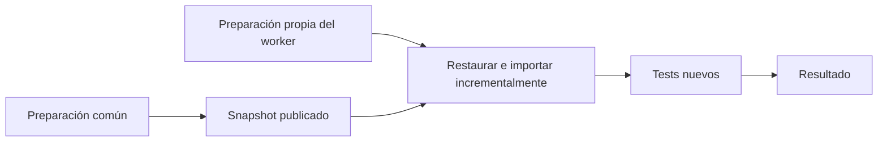

# Preparación de la verificación en GitHub Actions

Medición iniciada el 19 de octubre de 2026, en UTC. Todas las opciones usan seis particiones.

## Resultado

Compartir durante la misma corrida no mostró una mejora clara de espera con estas muestras.
Reutilizar importaciones ya disponibles sí redujo la espera observada. La condición es tener
un snapshot compatible del mismo commit. La CI habitual conserva seis particiones independientes.

| Preparación | Completas/sin cola | Mediana total | Rango | Ocupación acumulada mediana de jobs |
|---|---:|---:|---:|---:|
| Independiente | 3/3 | 6:18 | 6:18 a 6:43 | 2133 s |
| Completa, solapada | 3/3 | 6:48 | 6:45 a 8:25 | 2423 s |
| Importaciones, solapadas | 3/3 | 6:25 | 6:12 a 6:29 | 2255 s |
| Completa, reutilizada | 2/2 | 5:08.5 | 4:22 a 5:55 | 1429 s |
| Importaciones, reutilizadas | 3/3 | 4:18 | 4:10 a 4:23 | 1316 s |

La tabla usa las corridas completas sin cola significativa. En este cierre calificaron las catorce.

Los tiempos incluyen plan, preparación, espera del artefacto, transferencia, importación,
tests, publicación de reportes y resultado. La ocupación suma las duraciones de los jobs
ejecutados. La CPU del motor se informa por separado. Un worker esperando ocupa una VM
aunque consuma poca CPU.

Los [datos de cada corrida](preparacion-2026-10-19.json) y los
[datos por worker](preparacion-2026-10-19-workers.csv) conservan revisión, procedencia,
equipo, versiones, relojes, fases e inventario. Los intentos rechazados permanecen registrados.

## Qué se solapa

En la programación solapada, el productor y los workers inician después del plan.
Cada worker adelanta el trabajo propio de su modo. Conserva la misma VM para esperar,
descargar, restaurar y verificar. Separar esas tareas en jobs perdería el estado preparado.



El paquete completo evita checkout, instalación de gdtoolkit y descarga de Godot en cada worker.
Sólo adelanta setup de Python mientras espera al productor. El paquete de importaciones
adelanta también checkout, gdtoolkit y Godot, porque cada worker sigue necesitando esas tareas.
Ningún worker empieza los tests antes de restaurar y validar los recursos.

Se usa el mismo cuerpo de worker para las programaciones serial y solapada.
El agregado exige éxito del productor, aunque haya publicado el artefacto antes de fallar.
La espera consulta el artefacto con ETag autorizado y tiene un límite.
GitHub documenta la disponibilidad inmediata del artefacto y las consultas condicionales.
[Artefactos](https://github.com/actions/toolkit/blob/main/packages/artifact/README.md),
[consultas condicionales](https://docs.github.com/rest/guides/best-practices-for-integrators).

La comparación mide cada alternativa contra la preparación independiente con seis particiones.
No atribuye una diferencia exacta al solapamiento frente a los pilotos seriales del informe anterior.
Aquellos pilotos usaban otras cantidades de particiones y una sola muestra.

## Reutilizar una preparación anterior

Los reusos obtienen un snapshot de una corrida anterior terminada con éxito.
El productor actual queda omitido. Los tests se ejecutan de nuevo y generan JUnit nuevo.
El paquete no contiene reportes ni resultados de tests.

La fuente se elige por corrida explícita, tipo e intento. Los workers registran el ID
inmutable del artefacto, digest, tamaño, edad y espera. No seleccionan el último éxito disponible.
Validan workflow, rama, commit y entorno. El snapshot completo se ancla también al SHA
externo del consumidor, para evitar validarlo contra su propio `.git` restaurado.

- [39189741778](https://github.com/federicohermo/nosefia/actions/runs/39189741778). 1,593,498,988 bytes, 194 s de job productor y 8:25 para la verificación inicial completa. Ocupó 2807 s de jobs.
  La serie observada de 3 verificaciones, incluida esa primera corrida, ocupó 5665 s. Su media fue 1888.3 s por verificación.
- [39190252281](https://github.com/federicohermo/nosefia/actions/runs/39190252281). 48,813,414 bytes, 172 s de job productor y 6:29 para la verificación inicial completa. Ocupó 2334 s de jobs.
  La serie observada de 4 verificaciones, incluida esa primera corrida, ocupó 6284 s. Su media fue 1571.0 s por verificación.

La latencia de un reuso excluye el productor que terminó antes de esa corrida.
Su costo inicial se conserva aparte. Una serie de verificaciones incluye la corrida inicial
completa y los consumidores posteriores. Su ocupación media suma ambos y divide por el total
de verificaciones. El job productor es sólo una parte del costo de esa primera corrida.
Eso no convierte el costo inicial en cero ni lo agrega artificialmente a cada latencia cálida.

El resultado cálido requiere un snapshot compatible ya disponible para la misma revisión.
No mide una política automática de caché ni su tasa de aciertos después de cambiar el juego.
Ante un origen ausente, expirado o incompatible, el experimento falla sin preparación alternativa.

## Método

Se congeló la medición en `01f69af929db3b5a14682246998aa44cf3c75427`.
El juego conserva los árboles de `src`, `test` y `assets` de
`d72aae87217482bc6f336ec8d894547c98048338`, usados en la comparación de particiones.
La misma revisión se conserva entre productores y consumidores.

Cada corrida completa ejecuta las mismas 304 suites únicas y los mismos 2.287 casos.
Se cotejan las rutas y el multiset exacto de nombres de casos, además de los totales.
Se exigen cero errores, fallos y saltos. Cada worker registra una importación y una
invocación real de tests. La última partición ejecuta también los demás nodos del verificador.

El tiempo total va de `created_at` del workflow al último `completed_at` de sus jobs.
El sondeo del recolector no agrega tiempo a esa medida. Se conservan todas las corridas.
Para las medianas sin cola, ningún job ejecutado puede esperar más de quince segundos
entre su creación y su inicio. La variación de checkout permanece incluida.

Se alternan las configuraciones y se registran las comprobaciones de capacidad antes de despachar.
El presupuesto inicial fue veinte jobs con una reserva. Se redujo a catorce tras observar
cola durante el primer piloto, antes de su resultado. La ocupación fuera del repositorio no se controla.
Un fallo de lectura del coordinador se reintentó sin repetir los experimentos ya completos.

Se habían previsto cinco muestras por alternativa. El usuario pidió cerrar usando la evidencia
disponible, después de observar los primeros reusos. Se detuvieron las repeticiones generales.
Se conservaron las corridas lanzadas y se agregó una confirmación del reuso de importaciones.
El cierre tiene tres controles, tres corridas solapadas por tipo y dos reusos completos.
Los reusos de importaciones suman tres. Las corridas con cola también se conservan, sin reemplazarlas.

Las medianas y los rangos son descriptivos. La detención adaptativa y las muestras pequeñas
impiden presentar las pruebas de rangos exploratorias del JSON como confirmación estadística.
No se mezclan estos controles con los cinco históricos de seis particiones.

Todas las corridas completas usaron ubuntu24, imagen `20261012.334.1`, cuatro vCPU,
Python 3.13.16, Godot `4.7.2.stable.official.ed1daf0bf` y gdtoolkit 4.5.0.
Hubo seis modelos de CPU reportados. El CSV conserva esos modelos y la carga al inicio.
GitHub asigna los equipos; no se controlan su carga externa ni su ancho de banda.
Los efectos observados incluyen esa variación y no fijan una latencia universal.

La importación independiente por worker tomó 92.1 a 182.7 s. Con preparación restaurada, tomó 4.4 a 16.8 s.
La descarga del paquete completo reutilizado varió entre 14 y 133 s.
La preparación fría y la transferencia limitan el ahorro de espera de los modos compartidos.
Los tiempos de tests siguen dentro de la medición. No se elimina su ejecución.

| Preparación | CPU Godot mediana, productor y workers |
|---|---:|
| Independiente | 3151.2 s |
| Completa, solapada | 819.3 s |
| Importaciones, solapadas | 880.4 s |
| Completa, reutilizada | 486.4 s |
| Importaciones, reutilizadas | 442.8 s |

La CPU suma tiempo de procesos, por lo que puede superar el tiempo de pared.
Reducir esa CPU no implica reducir en igual medida la espera ni la ocupación de VMs.
Con dos reusos completos no se establece una clasificación estable frente al paquete pequeño.

La comparación corresponde a este juego, estos paquetes y estas seis particiones.
No demuestra un óptimo global ni cambia la conclusión histórica del informe de particiones.
La CI habitual valida por separado la integración actual de staging.

## Intentos que no completaron el verificador

Antes de congelar la revisión corregida, el piloto completo
[39188978402](https://github.com/federicohermo/nosefia/actions/runs/39188978402)
ejecutó las 304 suites sin fallos. El harness rechazó una oración de 28 palabras en la guía.
El resultado completo fue rojo y no cuenta como éxito.

El piloto de importaciones
[39189204949](https://github.com/federicohermo/nosefia/actions/runs/39189204949)
tuvo dos workers en cola. Se canceló manualmente al conocer el mismo defecto de documentación.
Quedaron resultados parciales. No fue un timeout y no cuenta como éxito.
Se corrigió la oración y se volvieron a generar las dos semillas en el commit congelado.

Las 14 corridas de la revisión congelada completaron el verificador.
No hubo fallos de tests, errores ni saltos en ellas.

Ninguna corrida completa quedó excluida por cola.

Incluyendo la cola, los 3 reusos de importaciones tienen mediana 4:18 y rango 4:10 a 4:23.
La diferencia entre incluir y excluir colas queda visible; no se descuentan segundos de las corridas.

La recolección local del segundo reuso completo falló al encontrar archivos ya descargados.
Se volvió a descargar sólo la evidencia. El workflow remoto no se repitió por ese error.

La CI habitual tuvo además un timeout de veinte minutos en una partición.
Su [segundo intento](https://github.com/federicohermo/nosefia/actions/runs/39189646492/attempts/2)
pasó sin cambios de código entre intentos. La causa del proceso Godot sin terminar sigue
sin determinarse. Este resultado no demuestra que compartir la preparación corrija ese problema.

## Repetir

En una rama con el medidor y el juego a comparar, crear primero una semilla.
Esperar su éxito completo y conservar la revisión antes de ejecutar los consumidores.

```bash
gh workflow run medir-verificacion.yml --ref <rama> \
  -f particiones=6 -f preparacion=importaciones -f programacion=solapada -f etiqueta=semilla
gh workflow run medir-verificacion.yml --ref <rama> \
  -f particiones=6 -f preparacion=importaciones -f programacion=reutilizada \
  -f corrida_previa=<run-exitoso> -f etiqueta=reuso-1
```

Para el paquete completo, usar `preparacion=compartida`. Para el control, usar
`preparacion=independiente` y `programacion=serial`. Repetir cada candidata al menos cinco veces.
Para una nueva confirmación estadística, fijar antes la cantidad de muestras y el criterio de detención.
Descargar `medicion-worker-*` y `medicion-preparacion` antes de un día.
Conservar la unión de XML y comprobar el mismo trabajo antes de aceptar cada tiempo.
Un commit posterior requiere una semilla nueva para ese SHA.

## Revisión y criterios aplicados

La revisión del diseño contrastó artefactos y caché exacta antes de implementar.
Se eligieron artefactos explícitos para medir el reuso sin agregar una política de caché.
Las pruebas del medidor y actionlint pasaron. La revisión de comentarios no encontró cambios necesarios.
Una revisión independiente recalculó relojes, inventarios, procedencia y costos desde los datos conservados.
Los catorce éxitos y 84 workers coinciden con las tablas. Corrigió el alcance del rango de importación restaurada.
No encontró bloqueos en esta conclusión descriptiva. La revisión usó el modelo heredado del agente principal.
No hubo diversidad entre familias de modelos.

- **Model the Domain.** Tipo y programación distinguen preparación actual y origen anterior.
- **Build the Lever.** El workflow permite repetir las alternativas sobre otras revisiones.
- **Explain the Number.** Se separan espera total, ocupación de VMs y CPU del motor.
- **Separate Before Serializing Shared State.** Un artefacto inmutable alimenta copias privadas.
- **Sequence Work into Verifiable Units.** Se verificaron semillas antes de habilitar sus consumidores.
- **Prove It Works.** Las corridas ejecutan el verificador real y cotejan JUnit nuevo.
