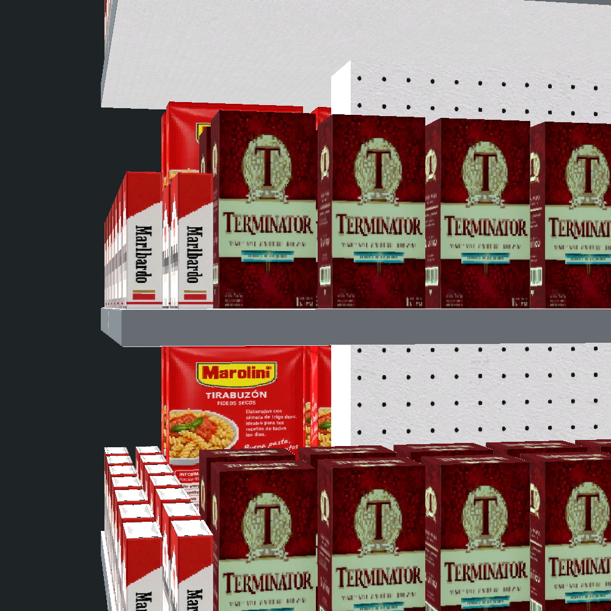
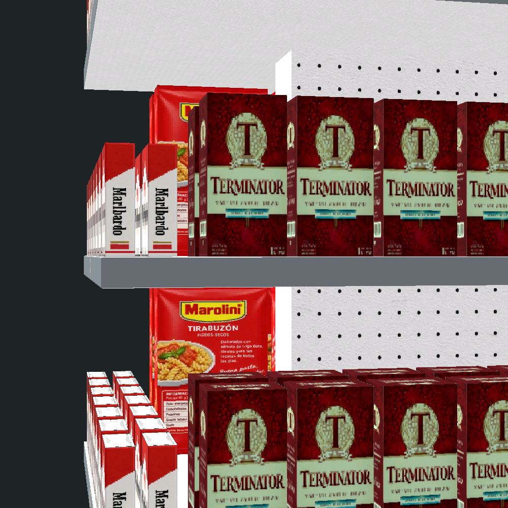
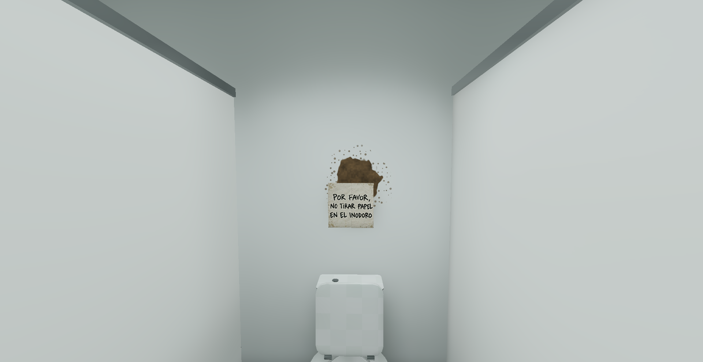
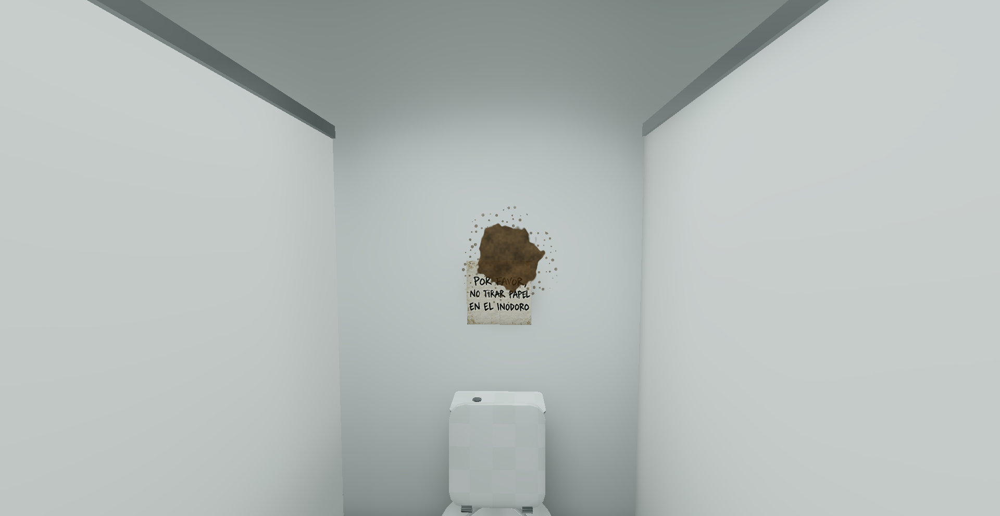
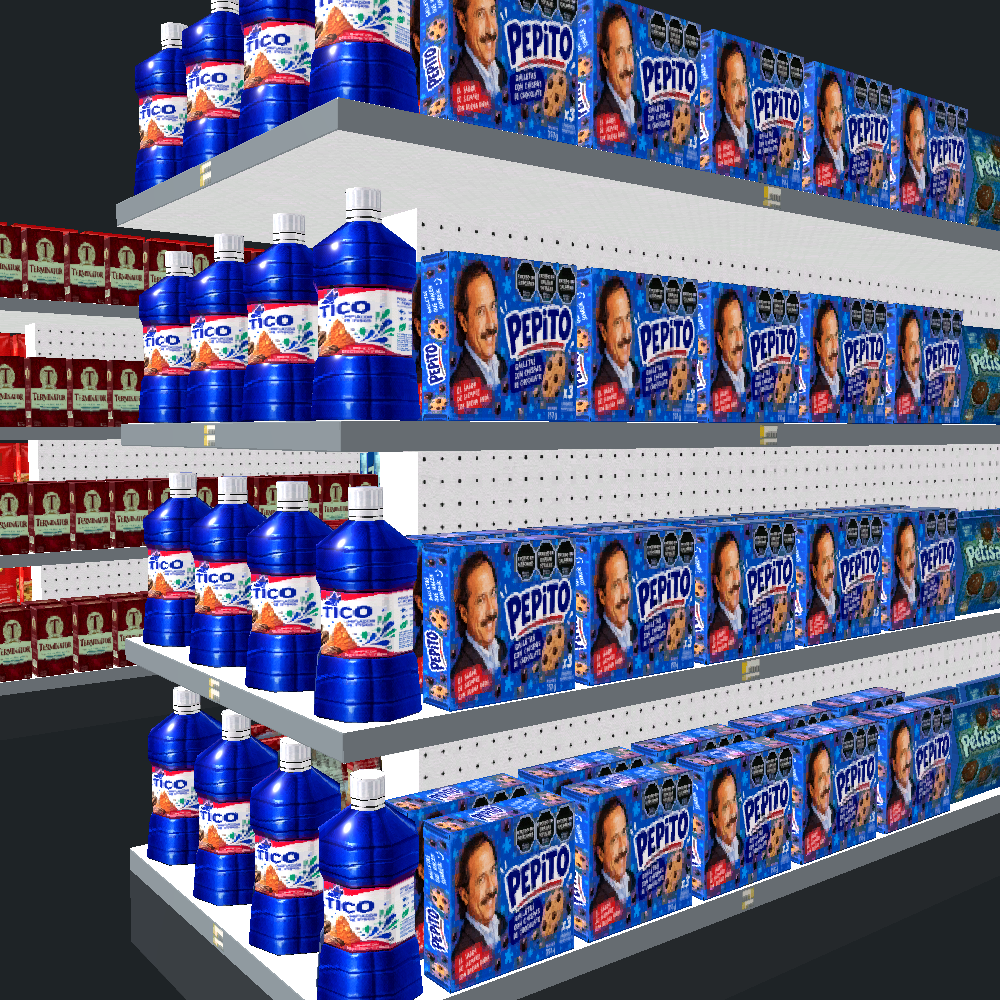
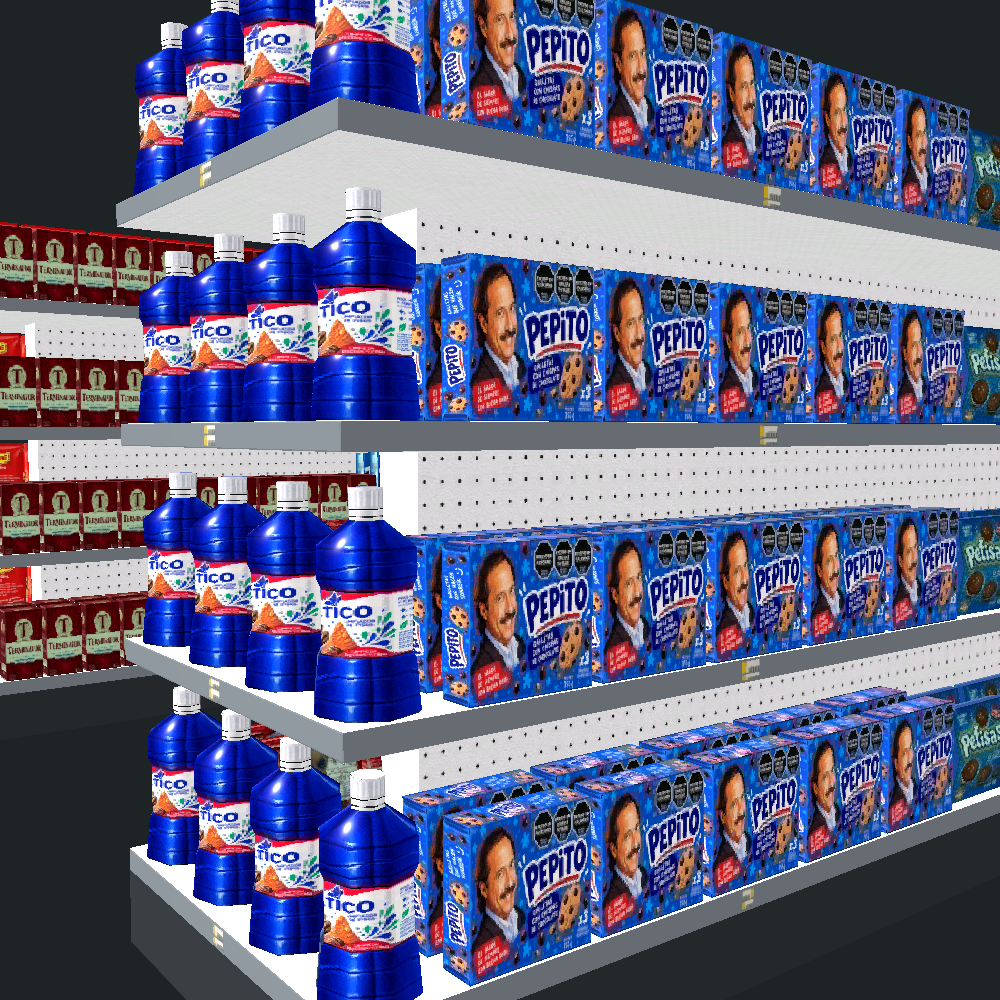

# Separación entre cabeceras y laterales

La referencia es la captura del usuario en la build web de `6afac29e`.
El PR conserva el mapa de productos y abre aire en los encuentros.

## Causa y corrección

Las bandas del tutorial compartían borde. Los márgenes dejaban sólo 7,5 mm entre envases de caras vecinas.
El control de intersecciones aceptaba ese resultado porque las mallas no se penetraban.

El generador retira 40 mm en cada extremo de los 16 estantes laterales de A y B.
Calcula las cantidades sobre el tramo original y después redistribuye los centros sobre el tramo reducido.
Rechaza un tramo que no conserve el hueco interior mínimo de 10 mm.

El modelo de esta revisión tiene cuatro plataformas horizontales por góndola.
Las normales medidas son `(0, 0, 1)`. Las rampas históricas de 14 cm en 60 ya no están en esta fuente.
El archivo blend conserva su SHA256 `ea9f786c595459ac8ef258585c2db4661385064f2715a7d10506af0887304731`.

## Medición

Blender 5.2.1 evaluó las mallas y el generador del tutorial.
Las dos salidas tienen 64 tandas y 784 unidades.
Cada tanda conserva producto, cantidad, fila, orden, condición fija y orientación.
Sólo cambia la coordenada longitudinal de 464 unidades laterales. Las profundidades y alturas permanecen iguales.

La tabla resume las 32 esquinas, con cuatro niveles medidos por fila.

| Góndola | Cabecera | Lateral | Niveles | Antes | Después |
| --- | --- | --- | --- | --- | --- |
| A | norte | este | 0, 1, 2, 3 | 7,5 mm | 47,5 mm |
| A | norte | oeste | 0, 1, 2, 3 | 7,5 mm | 47,5 mm |
| A | sur | este | 0, 1, 2, 3 | 7,5 mm | 47,5 mm |
| A | sur | oeste | 0, 1, 2, 3 | 7,5 mm | 47,5 mm |
| B | norte | este | 0, 1, 2, 3 | 7,5 mm | 47,5 mm |
| B | norte | oeste | 0, 1, 2, 3 | 7,5 mm | 47,5 mm |
| B | sur | este | 0, 1, 2, 3 | 7,5 mm | 47,5 mm |
| B | sur | oeste | 0, 1, 2, 3 | 7,5 mm | 47,5 mm |

La medición toma el hueco axial entre envolventes mundiales que solapan en los otros dos ejes.
El generador también comprobó todas las mallas de producto entre sí y no encontró intersecciones.
Los archivos `prueba-antes.json` y `prueba-despues.json` conservan las unidades, matrices y parejas medidas.
`comparar.py` contrasta ambas salidas y exige las invariantes anteriores.

## Capturas

Godot 4.7.2, con el motor nativo aprobado del proyecto, dibujó la disposición completa del tutorial.
El modelo se reexportó mediante `exportar_modelo.py` y se reimportó con la caché del GLB invalidada.
Las imágenes usan cámara idéntica antes y después, materiales importados e iluminación neutra de inspección.
El script `capturar.gd` conserva la cámara y el montaje de inspección.

| Antes | Después |
| --- | --- |
|  |  |
|  |  |
|  |  |

[Extremo norte después](despues-norte.png).

## Conservación y límites

El JSON del GLB reexportado es idéntico, incluidos nombres, jerarquía y materiales.
Los índices y las imágenes embebidas también son idénticos.
Sólo cambiaron redondeos de UV del exportador. Sus deltas máximos son `1,20e-7` y `2,39e-7`.
La geometría estática no cambió y no requirió otro horneado.

La auditoría topológica señala aristas con más de dos caras en Malbardo, tanto en fuente como en malla evaluada.
Es un defecto preexistente en el blend idéntico. Este cambio no modifica esa topología.
No se declara una auditoría topológica completamente verde.

Pasaron 70 pruebas focales del pipeline. No se ejecutó `verificar.py` local.
La CI del PR #595 pasó las seis particiones y el check final `verify`.
El seguimiento `gh pr checks 595 --repo federicohermo/nosefia --watch` terminó con código cero.
