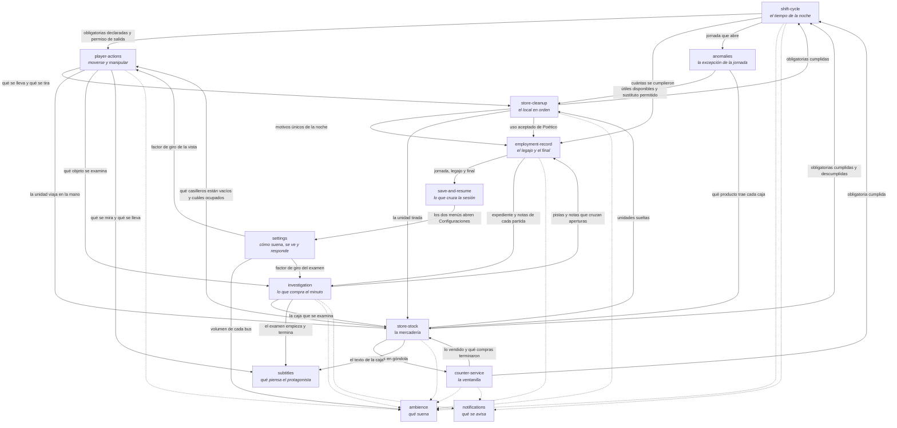

# Las capacidades y lo que pasa entre ellas

**El contrato de cada capacidad vive en su spec** —`specs/<capability>/<capability>.md`—, y su
código, en el `capability_id` del frontmatter. Este documento no lo repite: declara **lo que
pasa entre ellas**, que es lo único que ningún spec puede decir solo.

Las reglas de edición de un spec están en [`.claude/rules/specs.md`](../../.claude/rules/specs.md),
y se cargan solas al tocar ese árbol.

## Una capacidad no es una capa

Una capacidad es una tajada de lo que el juego **hace**: atender la ventanilla, reponer la
góndola, arrastrar el legajo entre noches. Una capa es dónde vive el código que la implementa.
Son dos ejes distintos y se cruzan: casi toda capacidad tiene piezas en `dominio/` y en
`sistemas/`, y varias tienen una en `escenas/`.

Por eso el spec no nombra archivos, clases ni escenas: lo pide
[la regla de specs](../../.claude/rules/specs.md).

## El mapa

La línea punteada expresa escucha sin respuesta. `ambience` escucha las señales de las demás.
El contrato de `notifications` incluye llegada, vencimiento, rechazo del lector, pista nueva
anotada, salida habilitada o trabada de nuevo, tiempo restante y cierre del turno.
Ninguna contesta a quien publica el suceso.
Por eso la tabla de sonidos es un archivo y no un `match`:
agregar un sonido no toca a quien lo emite.

## Las dos mitades de la resta

La tensión central del juego es aritmética, y en el mapa se lee de un vistazo. **`shift-cycle`
es la resta**, y las capacidades que le apuntan son lo que cada lado compra.

| Lado | Capacidades | Qué le hacen al turno |
|---|---|---|
| **Lo que el jefe pide** | `counter-service`, `store-stock`, `store-cleanup` | consumen tiempo **y** cumplen una obligatoria |
| **Lo que el jugador elige** | `investigation` | consume tiempo y **no cumple nada** |
| **El cuerpo** | `player-actions`, `subtitles` | no consume por sí mismo: el precio son los metros |
| **Lo que dura más que la noche** | `employment-record`, `save-and-resume` | no consumen: reciben el cierre |
| **Lo que ajusta el jugador** | `settings` | no consume ni cumple: cambia cómo se oye, se ve y se gira, nunca la resta |

Al evaluar una feature, la pregunta es de qué lado cae. Una que no toca esa resta es contenido,
no diseño.

## Las fronteras que más se rompen

Estos pares se confunden seguido, y cada uno tiene su regla escrita en los dos specs:

- **`counter-service` y `store-stock`.** Cobrar es de la ventanilla; cuántas unidades hay y dónde
  están, de la mercadería. La ventanilla **pregunta**, no lleva su propia cuenta.
  En la primera noche, la ventanilla recibe unidades físicas y la mercadería las retira una sola
  vez, al completar la venta. Si la compra vence, las unidades siguen afuera como unidades
  sueltas. Registrar espera a que terminen ambas compras, vendidas o vencidas. Después compara
  la planilla sólo con las ventas completas, sin depender de atención.

  La apertura comparte una sola selección de compradores y pedidos entre atención y reposición.
  La segunda noche usa los pedidos fijos de Fede y Mía, sus conversaciones propias y sus figuras
  en el mundo. Ninguna consulta reconstruye la lista de apertura.
  Sus compras vencidas también dejan las unidades recogibles en el piso interior, todavía
  registradas afuera, y descartan el ticket.

  Atención exige completar las dos compras.
- **`shift-cycle`, `store-stock` y `player-actions`.** Las jornadas de prueba permiten salir por
  la entrada mientras todas sus tareas estén cumplidas. Descumplir una vuelve a trabar la
  salida; recuperar todas la habilita de nuevo. La planilla conserva sus gestos de sumar y
  restar, y retirar mercadería vuelve a dejar reposición pendiente. La primera habilitación
  avisa una vez por noche y cada nueva traba produce su propio aviso. Recuperar retira el aviso
  de traba sin repetir el inicial. La puerta termina la noche por el mismo recorrido que el
  tiempo agotado, contando el cumplimiento actual. Abrir otra jornada vuelve a evaluar sus
  tareas y permiso propios. El reloj conserva el ritmo de esa jornada.
- **`player-actions` y `counter-service`.** Atención decide si corresponde hablar, recibir o
  terminar una conversación. El cuerpo traduce la consulta en referencia y gesto, y consume
  el clic de salida antes de volver al mundo. En atención física el foco sigue el alfa de la
  figura vigente; el hueco no es un objetivo. El recorrido genérico sin figura conserva una
  consulta de acceso al cobro que no bloquea cuerpos. El dibujo del contorno y el encuadre no
  llevan otra cuenta de pedido, inventario ni diálogo.
- **`player-actions` e `investigation`.** Agarrar y examinar son del cuerpo; **qué esconde** el
  objeto es de la investigación. La identidad de lo que se agarra es opaca a propósito: lo que se
  investiga no está en el catálogo.
- **`employment-record` y `save-and-resume`.** El legajo decide; el guardado sólo lo pone en
  disco y lo trae de vuelta.
- **`save-and-resume` y `settings`.** El guardado es la partida y se borra con ella; las
  preferencias son del jugador, viven en su propio archivo y ningún final las toca. Los menús
  son del guardado; lo que se ajusta adentro de Configuraciones, de `settings`.

- **`anomalies` y `store-cleanup`.** La anomalía decide qué útil falta y qué sustituto queda
  habilitado por jornada; limpieza decide el efecto y sus rechazos. La segunda noche deja
  ausente el azul y habilita Poético para preparar esa mezcla, conservando la mercadería.
  Limpieza entrega el teñido aceptado con identidad; el legajo conserva el hecho para el cierre.
- **`anomalies` y `store-stock`.** La última noche la anomalía permuta qué producto trae cada
  caja del depósito. La mercadería decide cuánto entra, sale y se vende, sobre ese contenido real
  y sin crear identidades nuevas.
- **`employment-record` e `investigation`.** Cada partida posee un único expediente y sus notas.
  Investigación recibe ese estado, registra pistas y consulta hipótesis, sin escribir disco.
  Las revelaciones por examen conservan su cuenta independiente de las pistas por jornada.

## Dónde va una regla nueva

1. **¿Qué capacidad decide esto?** Si la respuesta es «dos», la regla está mal partida: una de
   las dos la consume.
2. **¿Se puede ejercer sin levantar una escena?** Si sí, el código va en `dominio/`. Si no, mirá
   otra vez — casi siempre se puede, y lo que no se puede es *dibujarla*.
3. **¿El GDD ya lo decidió?** Entonces el spec dice eso, aunque el código todavía diga otra cosa.
   Esa diferencia es el hallazgo, y sale en un issue.

Una capacidad nueva se abre sólo si la regla no entra en ninguna **y** no es regla de una de
ellas. Una capacidad de un solo criterio casi siempre es lo segundo.
